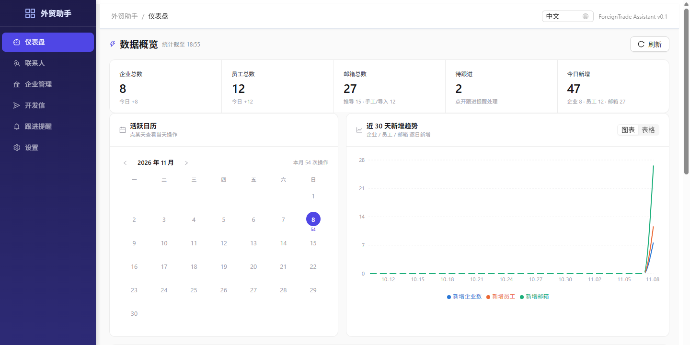
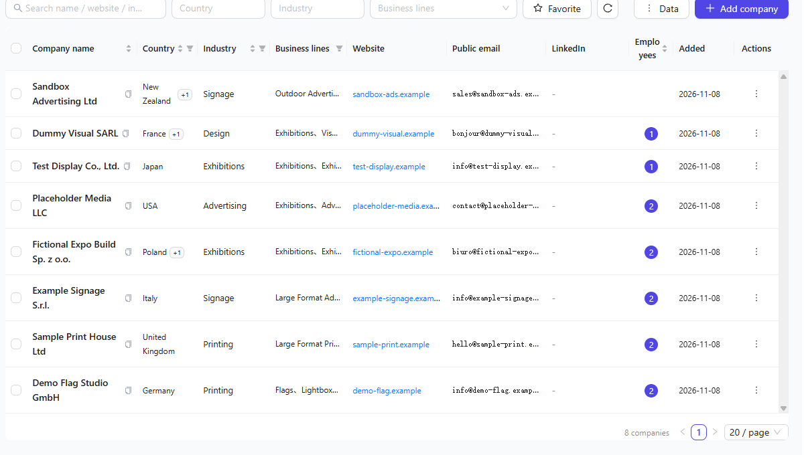
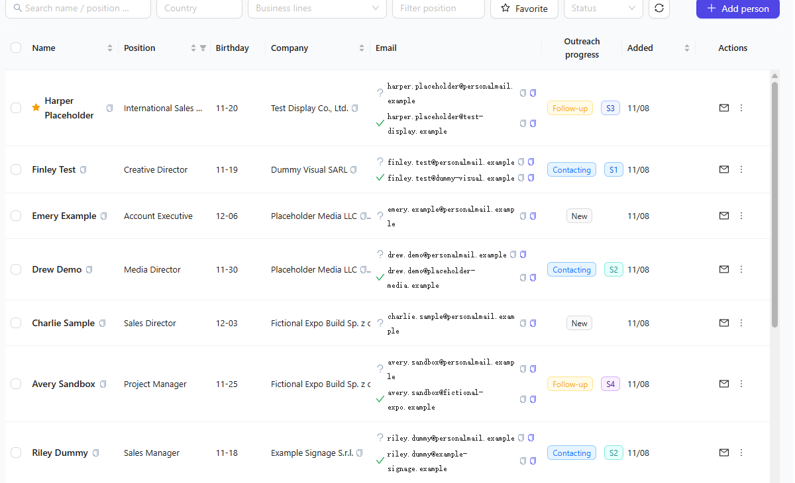
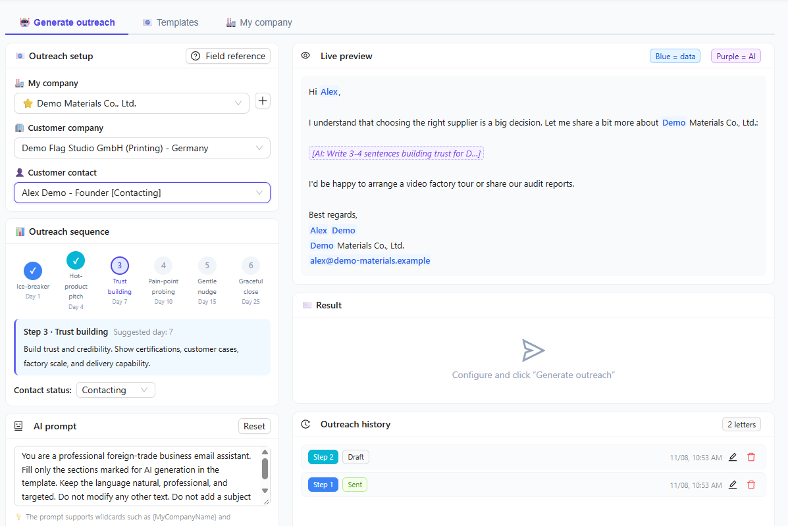
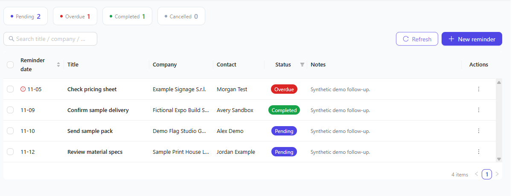
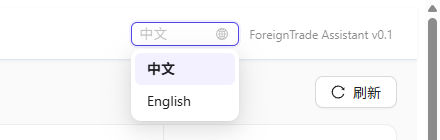
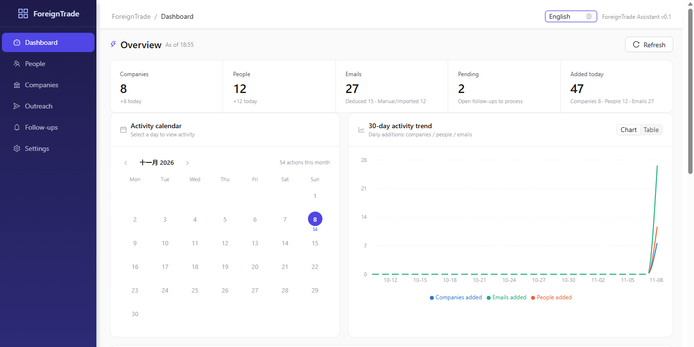

<div align="center">

# ForeignTrade · 外贸助手

**A local-first workspace for foreign trade customer development.**

管理客户与联系人 · 推导/校验邮箱 · 生成 AI 开发信 · 跟踪跟进

[](https://www.python.org/)
[](https://react.dev/)
[](https://fastapi.tiangolo.com/)
[](https://www.sqlite.org/)
[](LICENSE)
[](https://github.com/KakaWan/ForeignTrade)

[功能](#功能) · [界面预览](#界面预览) · [中英文切换](#中英文切换) · [快速开始](#快速开始) · [配置](#配置) · [Roadmap](#roadmap)

</div>



ForeignTrade 是一个本地运行的外贸客户开发辅助工具，把客户企业、联系人、邮箱、开发信和跟进记录放在同一个工作台里。默认使用 SQLite，数据保存在本机，不需要额外的云服务或账号系统。

适合个人外贸业务员、SOHO 和小团队内部使用。当前版本 `0.1.0`，仍在早期迭代，接口和数据结构可能调整。

> **设计边界**：不包含客户数据采集/爬虫，也不自动群发邮件；邮箱校验是启发式结果，不是确定性验证。

## 功能

- **客户与联系人管理** — 企业、联系人、多国家、多主营产品/业务、收藏、搜索筛选、批量操作、重复检测。
- **邮箱推导** — 按姓名 + 企业域名生成候选邮箱；内置保守/标准/全面三组格式，支持自定义和 AI 生成格式。
- **邮箱校验** — DNS（MX/SPF/DKIM）+ SMTP RCPT 多信号检测，输出 `valid` / `likely_valid` / `unknown`；限速、垃圾陷阱识别。
- **AI 开发信** — 6 步递进模板、`{字段}` 数据通配符、`{AI:指令}` 生成区、实时预览、多语言输出（与界面语言独立）。
- **Excel 导入导出** — 支持标准企业/员工模板和「外贸企业」模板；「外贸企业」模板可自动解析公共邮箱/联系人，遇到重复企业时按字段合并。
- **跟进与看板** — 跟进提醒、状态管理、KPI、活跃日历、趋势、国家/产品分布、近 30 天生日。
- **中英文界面** — 右上角下拉切换中文 / English，选择保存在本地；语言包结构可扩展。
- **本地优先** — SQLite 本地存储；数据库与设置可打包备份、恢复、上传和下载。

## 界面预览

> 以下截图使用虚构演示数据。


| 客户管理 | 联系人 |
|:---:|:---:|
|  |  |
| 多国家、业务线、邮箱与批量操作 | 邮箱推导、联系状态与开发进度 |

| AI 开发信 | 跟进提醒 |
|:---:|:---:|
|  |  |
| 6 步流程、模板通配符与实时预览 | 提醒日期、状态与关联客户 |

## 中英文切换

右上角提供语言下拉框，可在 **中文** 与 **English** 之间切换；选择会保存在浏览器本地存储中，刷新后保持。



| 中文界面 | English UI |
|:---:|:---:|
|  |  |

语言包位于 `frontend/src/i18n/locales/`：

- `zh-CN.ts` — 中文（源语言）
- `en-US.ts` — English

新增语言只需创建 `locales/<code>.ts`，导出一个 `LanguagePack`，并在 `frontend/src/i18n/index.tsx` 的 `languagePacks` 数组中注册。语言包以中文源字符串为 key，新增语言时可以复制 `en-US.ts` 并替换译文；缺失的键会自动回退到中文。

> 界面语言（中文 / English）与 AI 开发信输出语言（英语、德语、法语、西班牙语、意大利语、葡萄牙语、荷兰语、俄语、日语、中文）是两套独立设置。

## 快速开始

### 环境要求

- Python 3.11+
- Node.js 18+ 与 npm
- Windows 10/11 可直接使用 `.bat` 脚本；macOS / Linux 使用手动命令

### 一键启动（Windows）

```bat
git clone https://github.com/KakaWan/ForeignTrade.git
cd ForeignTrade

cd backend
python -m venv venv
venv\Scripts\activate
pip install -r requirements.txt
if not exist data mkdir data

cd ..\frontend
npm install
cd ..
start.bat
```

打开 <http://localhost:5173>。首次启动会自动执行数据库迁移，并写入默认邮箱格式、6 封开发信模板和产品目录。

> `start.bat` / `stop.bat` 会结束本机所有 Python/Node 进程，运行前请保存其他项目的工作。

### 手动启动

后端：

```bash
cd backend
python -m venv venv
source venv/bin/activate        # Windows: venv\Scripts\activate
pip install -r requirements.txt
mkdir -p data                   # Windows: if not exist data mkdir data
cp .env.example .env            # 可选；Windows: copy .env.example .env
python run.py
```

前端（另开终端）：

```bash
cd frontend
npm install
npm run dev
```

| 服务 | 地址 |
| --- | --- |
| 前端 | <http://localhost:5173> |
| 后端 | <http://localhost:8000> |
| API 文档 | <http://localhost:8000/api/docs> |

### 配置 AI

打开「设置 → AI 配置」，选择 Anthropic 或 OpenAI 兼容协议，填写 API Key、API 地址和模型，点击「测试连接」后保存。配置写入 `backend/config.json`，重启后生效。

也可以复制 `backend/.env.example` 为 `backend/.env`。配置优先级：内置默认值 < 系统环境变量 / `.env` < 设置页保存的 `config.json`。

## 配置

| 变量 | 默认值 | 说明 |
| --- | --- | --- |
| `AI_PROVIDER` | `anthropic` | `anthropic` 或 `openai` |
| `ANTHROPIC_API_KEY` / `OPENAI_API_KEY` | 空 | 对应协议的 API Key |
| `ANTHROPIC_BASE_URL` / `OPENAI_BASE_URL` | 官方地址 | 可替换为兼容网关 |
| `DB_ENGINE` / `DB_URL` | `sqlite` / `sqlite+aiosqlite:///./data/foreigntrade.db` | 默认 SQLite |
| `EMAIL_DEDUCE_MODE` | `disabled` | `disabled` / `manual` / `auto` |
| `EMAIL_VERIFY_MODE` | `manual` | `disabled` / `manual` / `auto` |
| `EMAIL_VERIFY_RATE_LIMIT` | `5` | 每分钟最多校验的邮箱数 |
| `CORS_ORIGINS` | `["http://localhost:3000", "http://localhost:5173"]` | 允许的前端来源（JSON 数组） |
| `BACKUP_ENABLED` | `false` | 是否开启定时备份 |

完整字段见 [`backend/app/core/config.py`](backend/app/core/config.py)，[`backend/.env.example`](backend/.env.example) 提供了一份带注释的模板。

## 技术栈

| 前端 | 后端 | 数据与集成 |
| --- | --- | --- |
| React 18 · TypeScript · Ant Design 5 · Zustand · Vite · Recharts | FastAPI · SQLAlchemy 2.0 (async) · Alembic · Pydantic 2 | SQLite · dnspython · aiosmtplib · openpyxl · Anthropic / OpenAI-compatible APIs |

<details>
<summary><strong>项目结构</strong></summary>

```text
ForeignTrade/
├─ backend/
│  ├─ app/
│  │  ├─ api/          # 企业、员工、邮箱、开发信、设置、备份等路由
│  │  ├─ core/         # 配置、数据库、缓存、路径
│  │  ├─ models/       # SQLAlchemy 模型
│  │  ├─ schemas/      # Pydantic 模式
│  │  ├─ services/     # 邮箱推导/校验、AI、导入导出、去重、备份
│  │  └─ main.py
│  ├─ migrations/      # Alembic 迁移
│  ├─ tests/           # pytest
│  ├─ .env.example
│  ├─ requirements.txt
│  ├─ run.py
│  └─ run_prod.py
├─ frontend/
│  └─ src/
│     ├─ api/ components/ hooks/ pages/ store/ types/ utils/
│     ├─ i18n/         # 语言包与切换逻辑（locales/zh-CN.ts、en-US.ts）
│     └─ App.tsx
├─ build/ForeignTrade.spec
├─ start.bat / stop.bat / build.bat
└─ README.md
```

</details>

## 数据与备份

- 开发模式下，数据库位于 `backend/data/foreigntrade.db`，备份位于 `backend/data/backups/`。
- 设置页保存的配置位于 `backend/config.json`；备份 `.zip` 包含数据库和该配置，可能含 API Key，请妥善保管。
- 打包版本中，数据库、配置和备份位于可执行文件所在目录。
- `.env`、`config.json`、数据库、备份和 Excel 数据文件已在 `.gitignore` 中忽略。

## Roadmap

- [x] 客户/联系人管理、Excel 导入导出
- [x] 邮箱推导与启发式校验
- [x] 6 步 AI 开发信与模板管理
- [x] 跟进提醒、仪表盘、备份
- [x] 中英文界面切换与可扩展语言包
- [ ] SMTP 自动发送
- [ ] 前端独立的手动邮箱校验入口
- [ ] 更多界面语言（日语、德语等）
- [ ] 后端错误信息双语化
- [ ] 更多自动化测试与 CI

## 说明

- **单用户、本地运行、无登录鉴权**：请勿直接暴露到公网。
- **邮箱校验是启发式的**：catch-all、灰名单、25 端口封禁等都会影响结果，不能保证 100% 准确。
- **当前版本不发送邮件**：SMTP 配置为后续功能预留；开发信生成后需手动复制发送。
- **PostgreSQL**：代码保留配置分支，但依赖中未包含 `asyncpg`；如需使用请自行安装。
- **数据合规**：请确保客户信息来源合法，并遵守目标地区的隐私与反垃圾邮件法规（如 GDPR、CAN-SPAM）。

## 开发与测试

后端测试（先激活 `backend/venv`）：

```bash
cd backend
python -m pytest
```

前端构建：

```bash
cd frontend
npm run build
```

> API 测试会使用应用当前配置的数据库，建议先执行 `alembic upgrade head`，并避免在生产数据上运行。

## 构建可执行版本（Windows）

需要已安装 Node.js，并已创建 `backend/venv`；首次构建会自动安装 PyInstaller。

```bat
build.bat
```

输出位于 `dist/ForeignTrade/`，双击 `run.bat` 启动，访问 <http://localhost:8000>（前端静态文件由后端提供）。

> `build.bat` 会把现有 `backend/config.json` 复制为 `dist/ForeignTrade/config.json.example`；如含真实 API Key，分发前请清理。

## 贡献

欢迎提交 Issue 和 Pull Request。提交前请尽量运行后端测试与前端构建，并在 PR 中说明改动目的和验证方式。

## 许可证

[Apache License 2.0](LICENSE)
